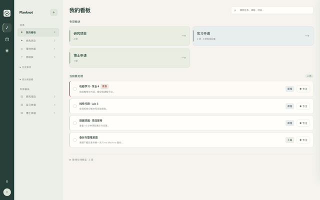
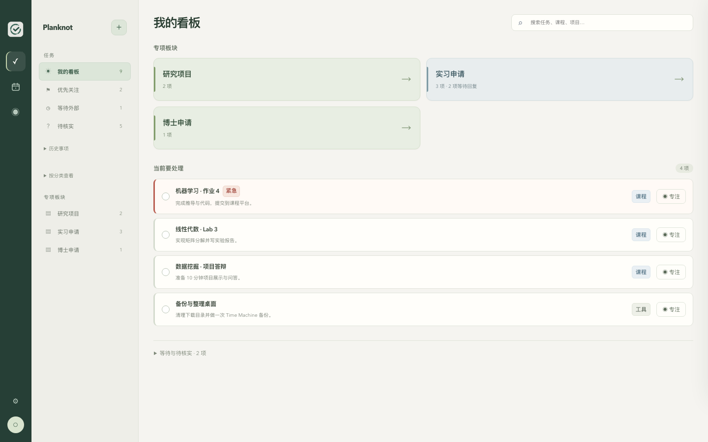
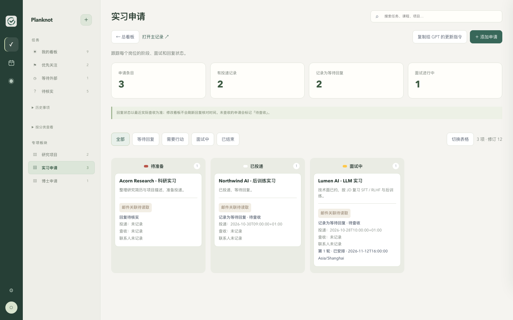
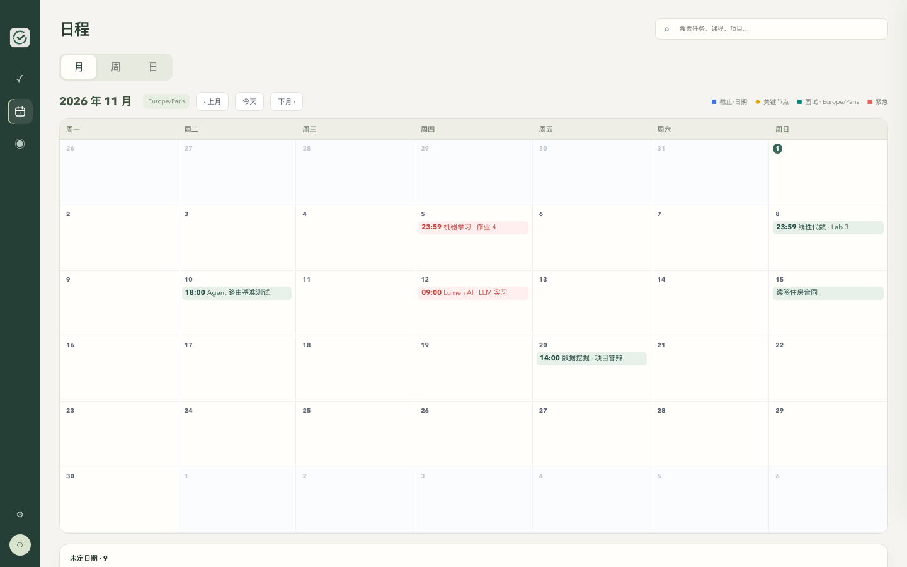
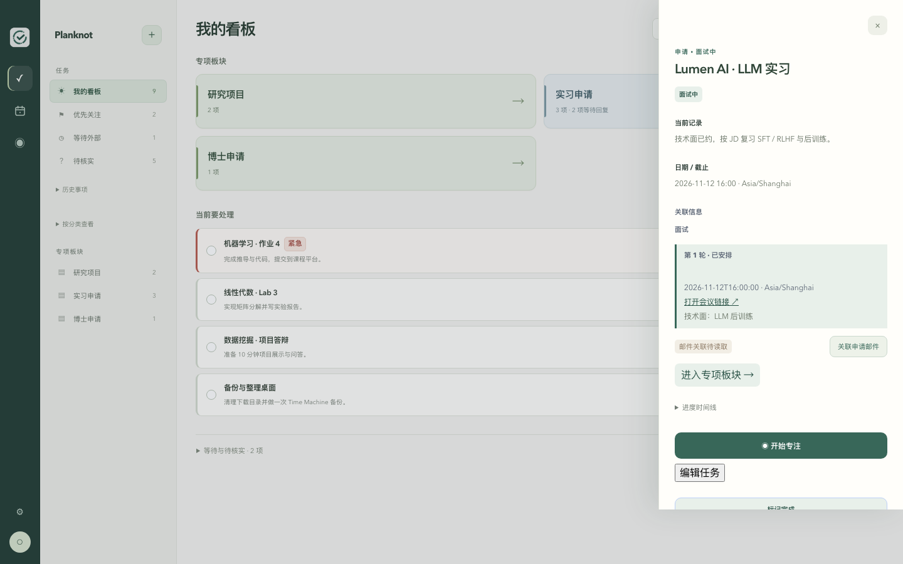
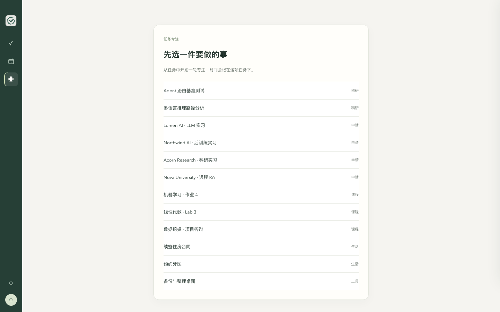
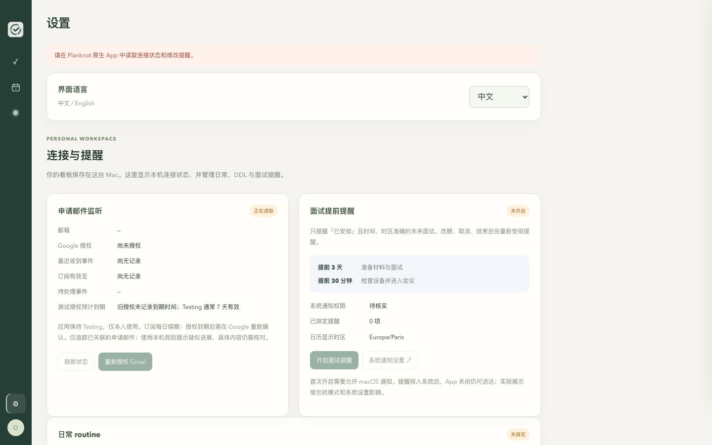

# Planknot

**把任务、资料和进展，系在同一块看板上。**

Planknot 是一款本地优先的 macOS 待办与项目看板应用，适合日常任务、课程作业、实习 / PhD 申请和研究项目。
名字来自 **Plan + Knot**：把计划与相关信息系在一起。



> 早期源码版本，欢迎试用和反馈。仓库暂未提供签名安装包，从源码运行需要 Xcode 与 XcodeGen。

## 功能特性

- **任务看板**：按「临近 / 进行中 / 等待外部 / 待核实 / 已完成」分栏；分类可自行增删，截止时间支持时区，支持完成与归档。
- **专项板块**：把大事项拆成子任务。申请类板块支持申请阶段、回复状态、联系人和多轮面试（时间 / 时区 / 会议链接）。
- **关联信息**：每个任务可按需添加面试、文档、网站、聊天等链接，资料不再散落各处。
- **日历**：月 / 周 / 日三种视图，DDL、关键节点和面试自动排入日历，并按所选时区换算。
- **专注计时**：把专注关联到具体任务，支持暂停 / 恢复与完成轮次记录。
- **桌面小组件与提醒**：DDL 默认提前 1 天 + 1 小时提醒，面试默认提前 3 天 + 30 分钟；小组件展示优先关注与未读进展。
- **中英双语**：界面一键切换。
- **本地优先**：所有数据保存在本机，无账号、无云同步。

## 截图

| 任务看板 | 申请板块 | 日历 |
| --- | --- | --- |
|  |  |  |

| 任务详情 | 专注 | 设置 |
| --- | --- | --- |
|  |  |  |

## 快速开始

### 从源码运行

准备：macOS 14 或以上、完整的 Xcode（安装后打开一次并完成初始化）、Python 3，以及 [XcodeGen](https://github.com/yonaskolb/XcodeGen)。用 Homebrew 安装 XcodeGen：

```bash
brew install xcodegen
```

下载并运行：

```bash
git clone https://github.com/wwx777/Planknot.git
cd Planknot
./develop.command
```

脚本会构建 App、准备本地资源并打开 Planknot。首次使用会创建空任务库，后续运行保留已有任务和设置。
构建失败时，请保留终端里的错误信息，方便反馈。

### 已拿到测试 App

如果维护者单独提供了 `Planknot.app`，还需要同版本源码文件夹：

1. 在源码文件夹中双击 `setup.command`，准备界面资源与任务库。
2. 打开 `Planknot.app`。
3. 在应用设置中开启需要的提醒，并允许 macOS 通知。

`setup.command` 只准备资源，不构建或下载 App。当前构建未配置 Developer ID 签名与公证，系统可能阻止首次打开；
确认来源后，可在「系统设置 → 隐私与安全性」中允许打开。

## 桌面小组件与提醒

- 桌面右键 →「编辑小组件」→ 搜索 **Planknot** → 添加。
- 从旧版 To Do List 迁移时，先移除旧小组件，再添加 Planknot。
- 小组件刷新由 macOS 调度，任务变化不保证立即显示。
- 普通 DDL 默认提前 **1 天和 1 小时**提醒；面试默认提前 **3 天和 30 分钟**提醒。
- 提醒需要明确的时间、时区及系统通知授权；勿扰模式可能影响弹窗展示。

## 数据与隐私

任务文件默认保存在：

```text
~/Library/Application Support/Planknot/desktop-radar/store/
```

界面偏好和专注记录另存于 App 的本地 WebKit 存储。源码公开不会公开使用者的本机任务：
任务库、个人配置、邮箱扩展与凭据均被 Git 忽略，不会随源码提交上传。

**目前没有跨设备同步。** 迁移或备份时需同时考虑任务目录和 App 的本地偏好。

## 当前限制

- 仅支持 macOS；尚未提供正式安装包、Developer ID 签名和公证。
- Gmail 自动提醒依赖另外配置的本机接收器和 OAuth 授权，**不随本仓库提供**；
  下载源码不会自动接入邮箱，也不会自动用 GPT 解读邮件。
- 与 AI 助手配合更新任务，需要另外接入本机命令行工作流；App 本身不内置模型服务。

## 参与开发

源码修改后重新运行 `./develop.command`，即可构建并更新本机运行资源。
配置、目录说明和验证方法见 [贡献指南](CONTRIBUTING.md)；版本记录见 [CHANGELOG](CHANGELOG.md)。

发现问题或有建议，欢迎提交 [Issue](https://github.com/wwx777/Planknot/issues)。
请说明 macOS 版本、操作步骤、预期与实际结果；截图请遮住个人信息。
